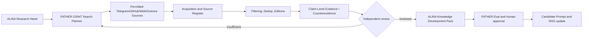

# ALINA Intelligence Research — OSINT-to-Knowledge Project
**Project ID AIR-001 | Version 0.1 | Status: DESIGN / HOLD | Date: 2026-10-16**

**Goal:** research the design and verification of ALINA Analyst: small stable system prompt, eight evidence-backed RAG layers, controlled tools, evaluation and knowledge decisions. This is a **research profile of FATHER OSINT_deepseek**, not a new scraper, autonomous deployment or standalone site.

## Architecture

## Document register
- [PROJECT_CHARTER.md](PROJECT_CHARTER.md) — purpose, scope, deliverables, stages, governance
- [SEARCH_MISSIONS.md](SEARCH_MISSIONS.md) — concrete searches, source policy and research questions
- [SOURCE_AND_EVIDENCE_PROTOCOL.md](SOURCE_AND_EVIDENCE_PROTOCOL.md) — source, claims, independence and licenses
- [DELIVERABLES_AND_ACCEPTANCE.md](DELIVERABLES_AND_ACCEPTANCE.md) — ten deliverables, acceptance metrics
- [INITIAL_EXECUTION_BACKLOG.md](INITIAL_EXECUTION_BACKLOG.md) — phases, ownership, pilot fixtures, blockers

## Existing canonical materials
- [Research Brief v1](../../agent_zoo/ALINA_ANALYST_OSINT_RESEARCH_BRIEF_V1.md)
- [Prompt v1 draft](../../agent_zoo/ALINA_ANALYST_SYSTEM_PROMPT_V1_DRAFT.md)
- [RAG Corpus v1](../../agent_zoo/ALINA_ANALYST_RAG_CORPUS_SPEC_V1.md)
- [Eval Matrix v1](../../agent_zoo/ALINA_ANALYST_EVAL_AND_RESEARCH_MATRIX_V1.md)

## Constraints
No live Telegram crawling, dependency installation, autonomous KB publication or prompt replacement from this design task. Existing FATHER OSINT implementation HOLD persists until Site + Agent/Model Zoo E2E, signoff and authorized scope. Source claims are evidence candidates, not verified conclusions.
