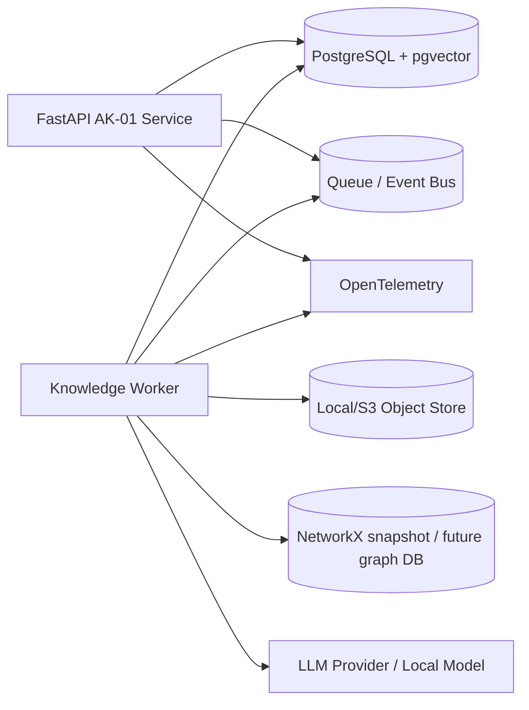

# AK-01 — Service Boundaries and Deployment View

## MVP deployment

## Evolution
MVP:
- modular monolith + worker
- PostgreSQL/pgvector
- NetworkX

Later:
- split heavy ingestion/extraction services
- dedicated graph DB if graph scale/query profile justifies it
- dedicated event bus
- provider routing
