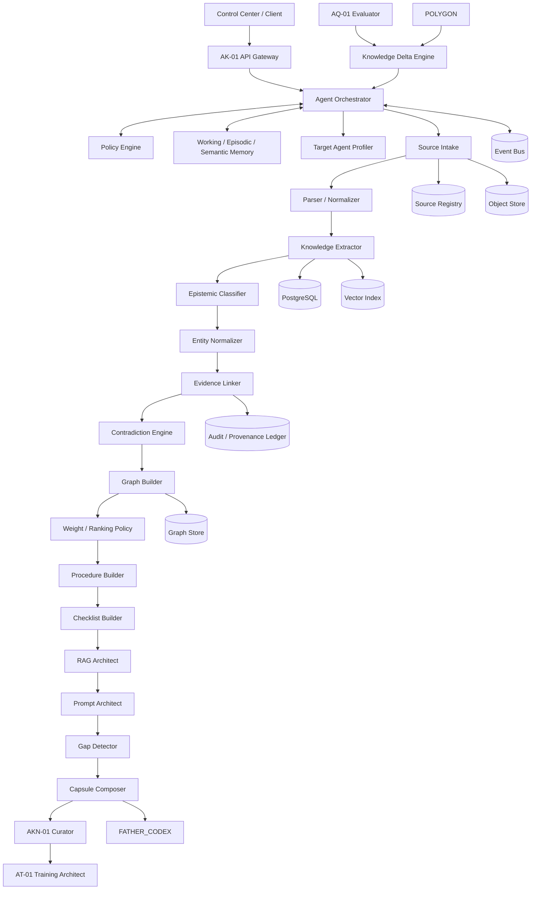

# AK-01 — Agent Architecture Package

Owner: AA-01 Agent Architect
Product: AK-01 ALINA Knowledge Architect

## Objective
Define AK-01 as an orchestrated agent system with explicit components, APIs, events, algorithms, failure modes, recovery actions and handoffs.

## Core principle
AK-01 is not a single prompt.
It is a controlled agent system composed of:
- deterministic services,
- LLM-assisted extractors/classifiers,
- retrieval components,
- policy engines,
- storage,
- validation,
- human review gates,
- monitoring and recovery.

## Top-level architecture

