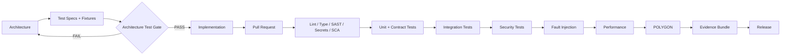

# AK-01 — Test-First DevSecOps Pipeline

## Development policy

1. Acceptance/contract tests are authored before production code.
2. New architecture requirement requires a corresponding test change.
3. Bug fix begins with a reproducing failing test.
4. Security bug begins with a negative/adversarial test.
5. Recovery logic requires fault-injection test.
6. No merge if mandatory gate fails.
7. Release evidence is produced automatically from CI/CD.

## Recommended tooling

- pytest
- pytest-asyncio
- Hypothesis for property-based tests
- Schemathesis or equivalent for OpenAPI property testing
- Testcontainers for PostgreSQL/queues where practical
- Ruff
- mypy/pyright
- Bandit
- Semgrep
- Gitleaks
- Trivy
- CycloneDX SBOM
- dependency audit tooling
- OpenTelemetry test traces
