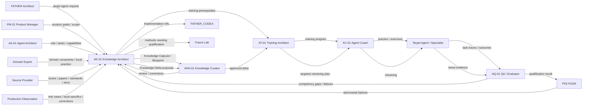

# AK-01 — Business Context Diagram

## Interpretation

AK-01 is not a one-time extractor. It is a continuous knowledge-engineering station.

It creates the initial specialist knowledge capsule and later accepts:
- training failures;
- real production cases;
- local organizational knowledge;
- human corrections;
- QA findings;
- POLYGON findings;
- newly published sources.

AK-01 analyzes them and produces a **Knowledge Delta** instead of silently rewriting the current capsule.

Final runtime qualification remains outside AK-01 authority.
