# AK-01 — Continuous Learning and Correction Loop

## Purpose

Training and real work reveal that the original knowledge capsule may be incomplete, too generic or locally wrong.

AK-01 must accept evidence from the specialist lifecycle and convert it into controlled change proposals.

```mermaid
flowchart LR
    CAPS[Specialist Capsule vN]
    TRAIN[Training]
    WORK[Real Work]
    FEED[Feedback / Cases / Corrections]
    GAP[Competency Gap Analysis]
    CAUSE[Root Cause Classification]
    DELTA[Knowledge Delta]
    REVIEW[AKN-01 Review]
    RETRAIN[Targeted Retraining]
    TEST[QA / POLYGON]
    NEW[Specialist Capsule vN+1]

    CAPS --> TRAIN --> WORK --> FEED --> GAP --> CAUSE --> DELTA --> REVIEW
    REVIEW -->|approve| RETRAIN --> TEST --> NEW
    REVIEW -->|rework| GAP
```

## Root-cause classes

- K1 KNOWLEDGE_MISSING
- K2 KNOWLEDGE_OUTDATED
- K3 KNOWLEDGE_INCORRECT
- K4 RETRIEVAL_FAILURE
- K5 PROCEDURE_MISSING
- K6 PROCEDURE_INCORRECT
- K7 CHECKLIST_INSUFFICIENT
- K8 DECISION_RULE_INCORRECT
- K9 PROMPT_POLICY_FAILURE
- K10 TOOL_SKILL_MISSING
- K11 LOCAL_KNOWLEDGE_MISSING
- K12 AGENT_CAPABILITY_MISSING

## Change routing

K1/K2/K3/K11 → Knowledge Base / Graph  
K4 → RAG  
K5/K6/K7 → Procedures / Checklists  
K8 → Decision Policy  
K9 → Prompt Package  
K10 → Training / Coach  
K12 → Agent Architecture / Tools

## Business safeguard

AK-01 proposes the change.
AKN-01 reviews the evidence.
AQ-01 verifies the effect.
POLYGON validates critical changes.
FATHER Gate approves the new capsule version.
