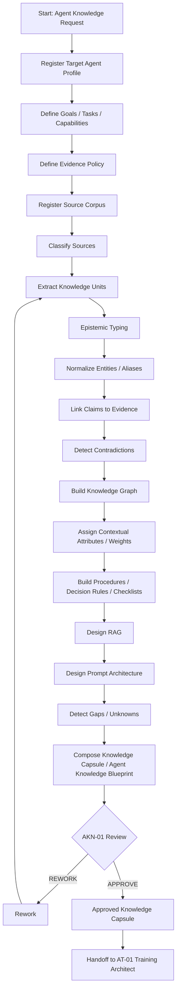
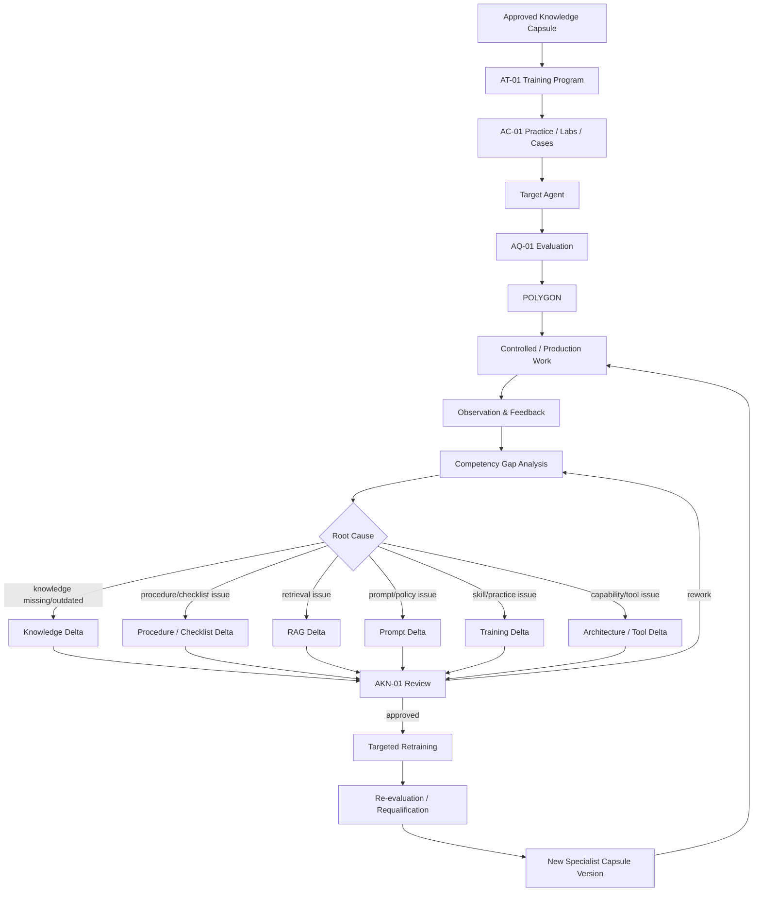

# AK-01 — End-to-End Business Process

## Initial specialist creation

## Training and adaptation loop

## Business rule

A specialist capsule is versioned and never silently overwritten.

Every significant change must produce:
1. change reason;
2. impacted knowledge/procedure/RAG/prompt nodes;
3. evidence;
4. approved delta;
5. targeted retraining where required;
6. re-evaluation;
7. new capsule version.
