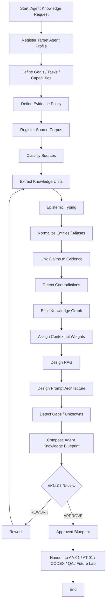

# AK-01 — End-to-End Business Process

## Business rule
No blueprint can be marked APPROVED without:
- provenance coverage;
- explicit unknowns;
- contradiction register;
- target-agent relevance mapping;
- reviewer decision.
