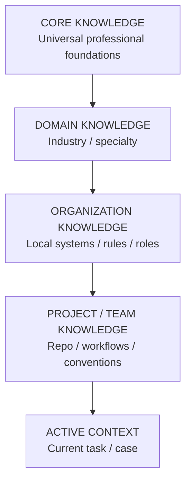

# AK-01 — Knowledge Layer Model

## Rules

### CORE
Stable professional foundations. Updated only with strong evidence and broad impact analysis.

### DOMAIN
Specialty knowledge: healthcare security, forecasting, OSINT, Kubernetes, etc.

### ORGANIZATION
Organization-specific architecture, policies, systems, SLA, escalation paths and local terminology.

### PROJECT / TEAM
Repository conventions, project workflows, local tools and current operating procedures.

### ACTIVE CONTEXT
Temporary task/case data. Must not automatically become permanent knowledge.

## Promotion rule

ACTIVE CONTEXT
→ repeated/validated pattern
→ PROJECT or ORGANIZATION candidate
→ AK-01 analysis
→ AKN-01 review
→ versioned Knowledge Delta

No context item is promoted merely because it appeared in one successful run.
