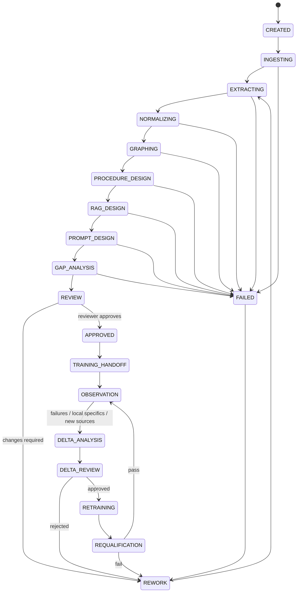
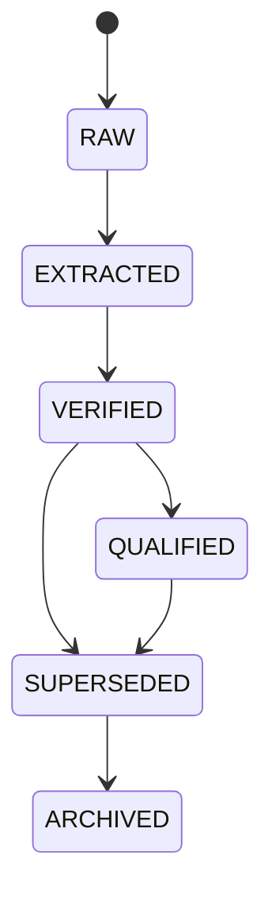
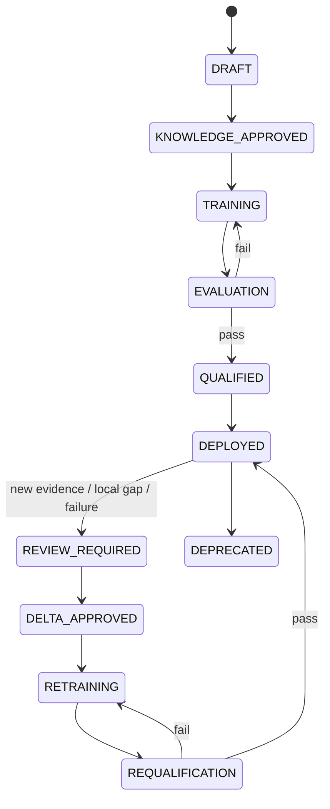

# AK-01 — Business State Model

## Knowledge Job states

## Knowledge Unit states

## Specialist Capsule states

AK-01 may propose deltas and support VERIFIED knowledge workflows.
AK-01 cannot independently promote runtime knowledge or a specialist capsule to QUALIFIED.
