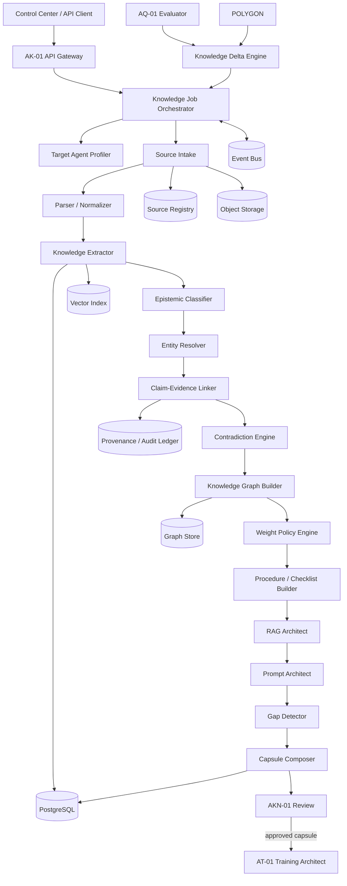

# AK-01 — Logical System Architecture

## Design principle

AK-01 is not one LLM prompt. It is an orchestrated system of deterministic services, retrieval, structured stores and LLM-assisted transformations.

LLM calls are replaceable implementation details inside selected modules.
